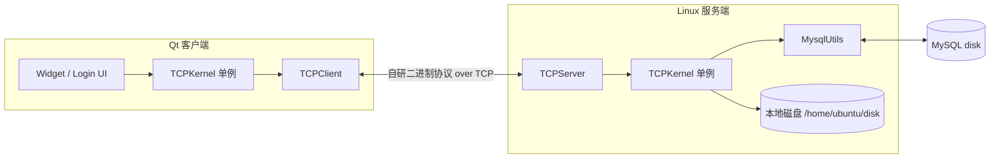

# NetDisk-byHan

一个基于 C++ / Qt 的个人云网盘，采用 C/S 架构：**Qt Widgets 客户端（Windows） + 原生 Socket 服务端（Linux / Windows 均可）**。

通信层没有使用 Qt 的 QTcpSocket，而是直接使用原生 socket API（Windows 下 Winsock2、Linux 下 POSIX socket）并自研了一套二进制应用层协议，用于完整实践网络编程中的粘包/半包处理、协议设计与性能调优。

---

## 功能

| 模块 | 说明 |
|---|---|
| 账号 | 注册、登录（注册后自动创建用户目录） |
| 文件 | 上传、下载、删除、文件列表 |
| 上传优化 | **MD5 秒传**（相同内容只存一份）、**断点续传**、**重复上传检测** |
| 分享 | 生成 8 位提取码，有效期 7 天，凭提取码转存到自己网盘 |
| 好友 | 添加好友（双向关系）、好友列表、**在线/离线状态实时显示** |
| 聊天 | 好友私聊（服务端在线转发，好友不在线时提示，并在列表中标记为离线） |
| 界面 | 头像 + 用户名显示、文件表格除文件名外只读、上传/下载实时进度条与网速、登录/注册双页切换 |

---

## 架构



### 并发模型

- 主线程 `accept`，**每个连接一个独立 `std::thread`**，连接之间互不阻塞；
- `TCPKernel` 为饿汉单例，统一持有网络层、存储层与在线用户表；
- **每个线程持有自己的 MySQL 连接**（`thread_local` 懒创建），避免多线程共享同一 `MYSQL*` 导致堆损坏；
- 主连接由心跳线程每 10 秒 `mysql_ping`，失败后重新 `mysql_init` 建连（不能复用已关闭句柄）；
- 在线用户表与上传任务链表分别由 `std::mutex` 保护；
- Linux 下忽略 `SIGPIPE` 并对 `send` 使用 `MSG_NOSIGNAL`，客户端意外断开不会杀掉服务端进程。

### 通信协议

```
+--------+--------+---------------------+
| 4 字节 | 1 字节 |     报文主体        |
| 长度   | m_type |  （具体结构体）      |
+--------+--------+---------------------+
```

- 接收端先循环读满 4 字节长度，校验范围后再读满包体，彻底解决 **TCP 粘包 / 半包**；
- 服务端对所有连接开启 `TCP_NODELAY`，避免 Nagle 算法与延迟 ACK 互等导致吞吐被压到 `4096 / RTT`（上传速度从 20 KB/s 提升到正常带宽）；
- 报文类型集中在 `pack.h`，客户端与服务端共用同一份定义；
- 协议结构体里不使用 `long`（Windows 4 字节 / 64 位 Linux 8 字节），统一用 `int` / `long long` 保证两端一致。

### 文件存储

```
<FILEPATHBASE>/            # Windows: D:/disk/   Linux: /home/ubuntu/disk/
└── <u_id>/                # 注册时创建的用户目录
    └── <f_md5>            # 文件名即 MD5，天然去重
```

`file` 表按 `f_md5` 唯一 + `user_file` 多对多映射，删除时按 `f_count` 引用计数决定是否真正删除物理文件。

---

## 数据库设计

数据库名 `disk`，共 5 张表 + 1 个视图：

```sql
CREATE DATABASE IF NOT EXISTS `disk` DEFAULT CHARACTER SET utf8 COLLATE utf8_general_ci;
USE `disk`;

CREATE TABLE IF NOT EXISTS `user` (
  `u_id` bigint NOT NULL AUTO_INCREMENT,
  `u_name` varchar(64) NOT NULL UNIQUE,
  `u_password` varchar(64) NOT NULL,
  `u_tel` bigint NOT NULL UNIQUE,
  PRIMARY KEY (`u_id`)
) ENGINE=InnoDB DEFAULT CHARSET=utf8;

CREATE TABLE IF NOT EXISTS `file` (
  `f_id` bigint NOT NULL AUTO_INCREMENT,
  `f_name` varchar(255) NOT NULL,
  `f_size` bigint NOT NULL DEFAULT 0,
  `f_uploadtime` varchar(64) NOT NULL,
  `f_path` varchar(260) NOT NULL,
  `f_count` bigint NOT NULL DEFAULT 1,
  `f_finish` int NOT NULL DEFAULT 0,
  `f_md5` varchar(64) NOT NULL UNIQUE,
  PRIMARY KEY (`f_id`)
) ENGINE=InnoDB DEFAULT CHARSET=utf8;

CREATE TABLE IF NOT EXISTS `user_file` (
  `u_id` bigint NOT NULL,
  `f_id` bigint NOT NULL,
  PRIMARY KEY (`u_id`, `f_id`)
) ENGINE=InnoDB DEFAULT CHARSET=utf8;

CREATE TABLE IF NOT EXISTS `shared_file` (
  `u_id` bigint NOT NULL,
  `f_id` bigint NOT NULL,
  `code` varchar(16) NOT NULL,
  `sharedtime` datetime NOT NULL
) ENGINE=InnoDB DEFAULT CHARSET=utf8;

CREATE TABLE IF NOT EXISTS `friend` (
  `u_id1` bigint NOT NULL,
  `u_id2` bigint NOT NULL,
  PRIMARY KEY (`u_id1`, `u_id2`)
) ENGINE=InnoDB DEFAULT CHARSET=utf8;

CREATE OR REPLACE VIEW `myview` AS
SELECT
  `uf`.`u_id`, `f`.`f_id`, `f`.`f_name`, `f`.`f_size`,
  `f`.`f_uploadtime`, `f`.`f_path`, `f`.`f_count`, `f`.`f_finish`, `f`.`f_md5`
FROM `user_file` `uf`
JOIN `file` `f` ON `uf`.`f_id` = `f`.`f_id`;
```

---

## 目录结构

```
NetDisk-byHan/
├── NetDiskClient/            # Qt 客户端
│   ├── Client/               # TCPClient：socket 封装、收发
│   ├── kernel/               # TCPKernel：信号槽、协议分发
│   ├── md5/                  # MD5 计算（秒传 / 去重）
│   ├── config.h              # ★ 服务器 IP / 端口
│   ├── pack.h                # 协议结构体（与 server 共用）
│   ├── login.* / widget.*    # 登录页与主界面
│   └── NetDiskClient.pro
└── NetDiskServer/            # 服务端
    ├── server/               # TCPServer：监听、每连接一线程
    ├── kernel/               # TCPKernel：业务逻辑 + 单例
    ├── mysql/                # MysqlUtils：MySQL C API 封装 + 心跳重连
    ├── config.h              # ★ 数据库 / 监听地址 / 存储路径
    ├── pack.h                # 协议结构体（与 client 共用）
    └── main.cpp
```

---

## 编译与运行

### 0. 初始化数据库

执行上面「数据库设计」中的 SQL 建库建表。

### 1. 客户端（Windows + Qt）

- 环境：Qt 5.15 + **MinGW 64-bit**（需与 MySQL 客户端库位数一致）
- 修改 `NetDiskClient/config.h` 中的 `SERVER_IP` / `SERVER_PORT`
- 用 Qt Creator 打开 `NetDiskClient.pro`，选择 **Desktop Qt 5.15.2 MinGW 64-bit**，构建运行

### 2. 服务端（Windows + Qt）

- 修改 `NetDiskServer/config.h`（MySQL 账号密码、存储路径）
- 用 Qt Creator 打开 `NetDiskServer.pro` 构建运行
- 若启动报「找不到 libmysql.dll」，把 `MySQL Server 8.0\lib\libmysql.dll` 复制到 exe 同目录

### 3. 服务端（Linux，推荐）

```bash
sudo apt update
sudo apt install -y build-essential libmysqlclient-dev default-mysql-server

mkdir -p /home/ubuntu/disk          # 与 config.h 中 FILEPATHBASE 保持一致

cd NetDiskServer
g++ -std=c++17 main.cpp kernel/tcpkernel.cpp server/tcpserver.cpp mysql/mysqlutils.cpp \
    -I/usr/include/mysql -lmysqlclient -lpthread -o NetDiskServer

./NetDiskServer
```

后台常驻运行：

```bash
nohup ./NetDiskServer > server.log 2>&1 &
tail -f server.log        # 查看日志
pkill NetDiskServer       # 停止
```

> 云服务器记得在安全组 / 防火墙放行 `8899`（TCP），并把 `SERVER_LISTEN_IP` 保持为 `0.0.0.0`。

---

## 配置项

所有可调参数集中在两个 `config.h`：

| 位置 | 配置 |
|---|---|
| `NetDiskServer/config.h` | MySQL 主机/端口/账号/密码/库名、监听地址与端口、文件存储根目录 |
| `NetDiskClient/config.h` | 服务器 IP、端口 |

---

## 已知限制 / Roadmap

- [ ] 上传任务在 UI 线程中同步发送，传输时界面不可操作 → 迁移到 `QThread`
- [ ] 断点续传进度只存在服务端内存，重启后失效 → 落库
- [ ] 文件仅平铺展示，无文件夹 / 移动 / 重命名
- [ ] 密码明文存储与明文传输 → 改哈希 + TLS
- [ ] SQL 使用字符串拼接，存在注入风险 → 改预处理语句 `mysql_stmt_*`
- [ ] 服务端信任报文中的 `userId`，可被伪造身份 → 登录时绑定 socket 与用户
- [ ] 每连接一线程，连接数多时开销较大 → 线程池 / epoll
